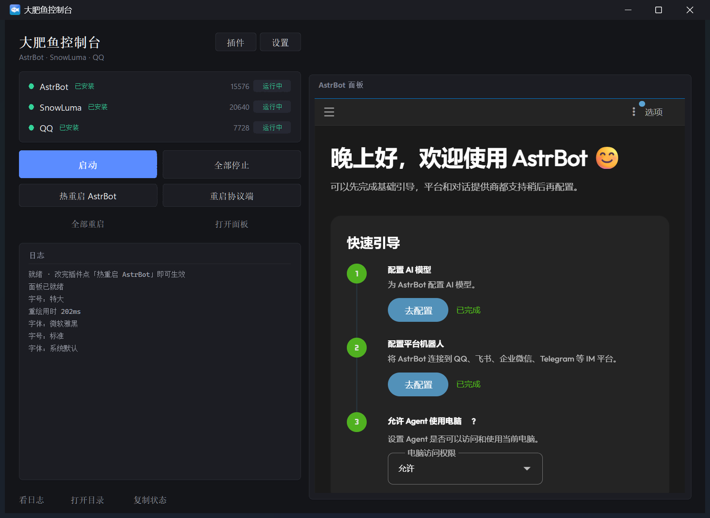

# 大肥鱼控制台 · Dafeiyu Console

> 一个把 **AstrBot 面板直接嵌进桌面窗口** 的启动器：左边一键启停，右边就是可交互的 AstrBot Dashboard，不用装 Python、不用开命令行、不用每次开浏览器。
>
> A desktop launcher that **embeds the AstrBot dashboard inside its own window**. Start/stop the bot on the left, operate the real AstrBot dashboard on the right — no terminal, no Python setup, no browser tab.



---

## 中文

### 这是什么

「大肥鱼控制台」是给 [AstrBot](https://github.com/AstrBotDevs/AstrBot) + [SnowLuma](https://github.com/SnowLuma/SnowLuma) 这套 QQ 机器人组合配的桌面控制台。它本身**不是**机器人框架，只做三件事：

1. **管进程**：一键启动 / 全部停止 / 热重启 AstrBot / 重启协议端，状态卡实时显示三个组件（AstrBot、SnowLuma、QQ）的进程号和运行状态。
2. **嵌面板**：把 AstrBot 的 WebUI 直接嵌进右侧卡片（Windows 原生窗口嵌入，不是 iframe），鼠标键盘都能用，登录一次长期有效；AstrBot 没启动时只显示「等待启动」，不会偷偷开浏览器进程。
3. **带新手走一遍**：首次启动自动进入四步向导——检查组件 → 启动服务 → 扫码登录 QQ → 连接机器人，缺组件可以一键下载（AstrBot / SnowLuma 自动装，QQ 跳官方下载页）。

### 功能

- 一键启停、热重启、状态与日志面板
- 内嵌 AstrBot Dashboard（可交互、跟随深浅色主题、随窗口缩放）
- 首次启动新手引导（含 SnowLuma 访问令牌在哪找、AstrBot aiocqhttp 怎么填）
- 缺少组件自动下载安装（GitHub 直连失败自动走镜像）
- 插件体检：按清单检查必要插件，区分已安装 / 需修复 / 未安装，支持单个修复与一键安装
- 浅色 / 深色 / 跟随系统主题，切换有淡出淡入动画
- 字号四档 + 字体可选，按 DPI 与分辨率自动适配
- 最小化回任务栏、关闭可最小化到托盘

### 系统要求

- Windows 10 / 11，64 位
- 首次使用需联网（要下载 AstrBot 与 SnowLuma，约 300–400 MB）
- 挂机器人需要一个 QQ 小号

### 下载与使用

到 [Releases](../../releases) 下载 `DafeiyuConsole-vX.Y.Z-win64.zip`，解压到**英文路径**（例如 `D:\DafeiyuBot`，不要放 `C:\Program Files`），双击 `大肥鱼控制台.exe`，跟着新手引导走即可。

详细步骤见 [docs/使用说明.txt](docs/使用说明.txt)。

### 从源码构建

```bat
cd tools
python -m venv buildenv
buildenv\Scripts\pip install pyinstaller pystray pillow psutil
buildenv\Scripts\python _mkver.py
buildenv\Scripts\pyinstaller --noconfirm --clean BotCtrl.spec
```

产物在 `tools\dist\BotCtrl.exe`；打包发布版（含内置 Python 与文档）用 `buildenv\Scripts\python tools\_release.py`。

### 目录结构（源码）

```
tools/
  bot_ctl.py         主程序（进程管理、路径、下载安装、Tk 入口）
  panel_ui.py        所有界面绘制与交互
  dashboard_view.py  把 Edge 窗口嵌进 Tk 卡片（SetParent + 裁剪 + 焦点转发）
  BotCtrl.spec       PyInstaller 打包配置
  release.json       版本 / 仓库 / 协议等发行信息（改这里）
  _mkver.py          由 release.json 生成 version_info.txt
  _release.py        出发布包（exe + 内置 Python + 文档 → zip）
  _make_icon.py      生成 bot.ico
  bot.ico            应用图标
docs/                截图与使用说明
```

### 协议

控制台本体使用 **MIT**，见 [LICENSE](LICENSE)。

它只是启动器与面板外壳，机器人能力来自下列项目，请一并遵守它们的协议：

- [AstrBot](https://github.com/AstrBotDevs/AstrBot) — AGPL-3.0
- [SnowLuma](https://github.com/SnowLuma/SnowLuma) — 见其仓库
- 以及你在 AstrBot 里安装的各个插件

---

## English

### What it is

**Dafeiyu Console** is a desktop launcher for the [AstrBot](https://github.com/AstrBotDevs/AstrBot) + [SnowLuma](https://github.com/SnowLuma/SnowLuma) QQ-bot stack. It is *not* a bot framework — it only does three things:

1. **Process control** — one-click start / stop-all / hot-restart AstrBot / restart the protocol backend, with a live status card (process id + state) for AstrBot, SnowLuma and QQ.
2. **Embedded dashboard** — the real AstrBot WebUI is embedded into the right-hand card as a native Windows child window (not an iframe). Mouse and keyboard work, the login session persists, and nothing is spawned while AstrBot is stopped (the card just says “waiting to start”).
3. **First-run guide** — a four-step wizard: check components → start services → scan the QR code to log in QQ → connect the bot. Missing components can be installed in one click (AstrBot / SnowLuma downloaded automatically, QQ opens its official download page).

### Features

- One-click start/stop, hot restart, status and log panel
- Embedded AstrBot dashboard (interactive, follows light/dark theme, resizes with the window)
- First-run onboarding, including where to find the SnowLuma access token and how to configure AstrBot's aiocqhttp adapter
- Automatic component download (falls back to GitHub mirrors when direct access fails)
- Plugin health check: installed / needs repair / missing, single repair and “install all missing”
- Light / dark / follow-system themes with a fade transition
- Four text sizes and font choices, scaled by DPI and screen resolution
- Minimize to taskbar; close to tray

### Requirements

- Windows 10 / 11, 64-bit
- Internet access on first run (downloads AstrBot and SnowLuma, ~300–400 MB)
- A spare QQ account for the bot

### Download & run

Grab `DafeiyuConsole-vX.Y.Z-win64.zip` from [Releases](../../releases), extract to an **ASCII path** (e.g. `D:\DafeiyuBot`, not `C:\Program Files`), then double-click `大肥鱼控制台.exe` and follow the wizard.

### Build from source

```bat
cd tools
python -m venv buildenv
buildenv\Scripts\pip install pyinstaller pystray pillow psutil
buildenv\Scripts\python _mkver.py
buildenv\Scripts\pyinstaller --noconfirm --clean BotCtrl.spec
```

Output: `tools\dist\BotCtrl.exe`. To produce the release archive (with bundled Python and docs), run `buildenv\Scripts\python tools\_release.py`.

### License

The console itself is **MIT** (see [LICENSE](LICENSE)). It only launches other open-source projects; please respect their licenses as well:

- [AstrBot](https://github.com/AstrBotDevs/AstrBot) — AGPL-3.0
- [SnowLuma](https://github.com/SnowLuma/SnowLuma) — see its repository
- Every plugin you install inside AstrBot
